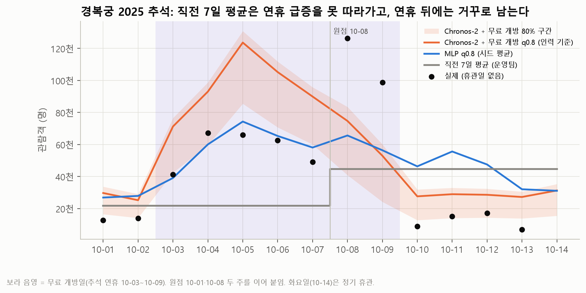

# 궁·능 관람객 수요예측과 인력 배치 권고

> 무료 개방일·명절에 개소마다 인력을 평소의 몇 배로 늘려야 하는가?

궁 4곳·종묘·조선왕릉 18곳, 모두 **23개소의 일별 관람객을 7일 앞서 예측**하고, 예측 오차를 **비용(원)** 으로 바꿔 개소별 권고 인력을 산출한 시계열 프로젝트입니다.

| 항목 | 내용 |
|---|---|
| 기간 | 2026.10 · AI Data Intelligence 부트캠프 팀 프로젝트 (4인) |
| 대상 | 궁·능 운영팀 (근무표 의사결정) |
| 사용 기술 | Python · pandas · PyTorch · Chronos-2 · MLP · 시계열 백테스트 · Colab |

<br>

## 결과 요약

**2025년 백테스트 비용 14.86억 → 8.46억 원 (−6.40억, 43%)**
기존 방식(직전 7일 평균) 대비, 공휴일·무료 개방 정보를 넣은 Chronos-2의 0.8 분위수로 인력을 배치했을 때입니다.

| 방식 | WAPE | 적중률 | 비용 (억 원) |
|---|---:|---:|---:|
| 직전 7일 평균 (기존 방식) | 0.444 | 0.582 | 14.86 |
| 직전 7일 평균 + 0.8 분위수 보정 | 0.444 | 0.804 | 13.20 |
| MLP (5개 시드 평균) | 0.339 | 0.785 | 9.66 |
| **Chronos-2 + 공휴일·무료 개방 (최종)** | **0.293** | **0.804** | **8.46** |

- 최종 모형은 시험 원점 52개 중 **39개에서 WAPE 최저**
- 달력 정보가 줄인 비용 1.62억 원 중 **94%가 무료 개방 주**에서 발생

### 운영 권고

| 개소 유형 | 증원 기준 (평소 대비) |
|---|---|
| 궁 | 명절 당일·이후 **4배**, 매월 마지막 수요일 **1.8배** |
| 종묘 | 마지막 수요일 **4배 이상** (실측 4.3배) |
| 왕릉 | 무료 개방(1.5배)보다 **평일 공휴일(2.5배)** 기준으로 증원 |

- 인원 = 예측 0.8 분위수 ÷ 2,000명 (올림)
- 근무표는 원점 전날 확정이 가장 싸지만(8.46억), 1~3주 전에 확정해도 9.22~9.44억으로 증가 폭이 1억 원 안쪽
- 배수는 2023~2025년 실측 중앙값이며 인과 효과가 아닙니다



<br>

## 문제 설정

| 항목 | 정한 것 | 이유 |
|---|---|---|
| 예측 단위 | 개소 × 날짜, 7일 앞 | 근무표를 개소마다 짠다. 합계로 평가하면 오차가 상쇄돼 15% 좋아 보인다 |
| 검증 | 2025-01-01부터 7일 간격 원점 52개 백테스트 | 원점 이전 데이터만 써서 미래 정보 누수를 막는다 |
| 1순위 지표 | WAPE, 최종 결정은 비용(원) | 정확도보다 운영 손실이 의사결정 기준 |
| 비용 구조 | 1명 부족 60만 원, 1명 과잉 15만 원, 1명이 하루 2,000명 담당 | 임계비율 60 ÷ (60 + 15) = **0.8 분위수** |
| 무료 개방일 | 달력 규칙(명절 연휴 + 매월 마지막 수요일) + 사전 공지 | 유료 관람객 수(`paid`)는 당일이 지나야 알 수 있어 사용하지 않음 |

<br>

## 데이터 처리에서 막은 실수

| 실수 | 측정한 영향 | 대응 |
|---|---|---|
| 휴관일 0을 수요로 학습 | WAPE 0.480 → 0.600 (**+12.0%p**) | 휴관·결측은 빈칸 처리, 학습·평가에서 제외 |
| `paid == 0`을 무료 개방일로 봄 | 개소마다 유료 기록 방식이 다름 (왕릉은 무료가 아닌 날에도 0 다수), 당일 값이라 누수 | 예측 입력은 달력 규칙만 사용 |
| 빠진 날짜를 0으로 채움 | 22개소 1,166행 누락 | 날짜 × 개소 격자로 맞추고 학습 구간 밖에 둠 |
| 합계로 평가 | WAPE 0.293 → 0.250, 15% 좋아 보이는 착시 | 개소 × 날짜 단위로 평가 |
| 당일 날씨 사용 | 완벽한 예보를 가정해도 비용이 줄지 않음 | 원점 전날 실측까지만 사용, 최종 모형에서 제외 |

<br>

## 데이터

| 파일 | 행 | 내용 | 출처 |
|---|---:|---|---|
| `raw/heritage_visitors_daily.parquet` | 62,028 | 날짜 × 개소 관람객 (유료·무료·내외국인) | 국가유산청 궁능유적본부 (공공데이터포털) |
| `raw/sites.csv` | 23 | 개소 구분·좌표·정기 휴관 요일 | 국가유산청 국가유산 검색 오픈API |
| `raw/weather_daily.parquet` | 92,414 | 개소 좌표의 일별 기온·강수 | NASA POWER |
| `raw/calendar_kr_2015_2025.csv` | 4,018 | 공휴일, 설·추석까지 날 수, 마지막 수요일 | Python `holidays` |
| `raw/anchors.json` | | 검산값 (행 수, 합계 등 7개) | |

학습은 코로나 영향을 피해 **2023년 이후** 자료만 사용했습니다. 자세한 내용은 [`raw/README_데이터.md`](raw/README_데이터.md)에 있습니다.

<br>

## 폴더 구조

```
├── report/       최종 보고서(report.md), 운영팀 제언, 그림 8장
├── notebooks/    01 데이터·베이스라인 → 02 모형 비교·FVA → 03 오차 분석 → 04 비용·확정 시점 → 05 2026 권고표
├── data/         분석 결과 (백테스트 예측, 지표, 시나리오, 권고표, 부족 상위 10건)
├── raw/          원본 데이터 5종과 데이터 설명
├── src/          hv.py (전처리·백테스트·비용) · dl.py (MLP · Chronos-2)
├── tools/        결과를 만든 스크립트
└── appendix/     보고서 부록 표
```

## 실행

```bash
pip install pandas pyarrow matplotlib holidays==0.103
```

- `notebooks/02 ~ 05`는 `data/`만 있으면 실행됩니다. 실행 결과가 저장돼 있어 열기만 해도 볼 수 있습니다.
- `notebooks/01`은 `raw/`와 `src/`를 사용합니다.
- 모델 재학습은 노트북에 포함하지 않았습니다. 결과는 `data/backtests.parquet`에 있고, 다시 돌리려면 `tools/run_day2.py`(MLP), `tools/run_colab_v3.py`(Chronos-2, Colab T4)를 사용합니다.

<br>

## 내 역할 — 분석 검증·통합

- **`paid == 0` 누수 발견:** 개소마다 유료 기록 방식이 달라 `paid == 0`이 무료 개방일을 뜻하지 않고, 당일이 지나야 아는 값이라는 점을 개소 유형별 일치율로 확인해 팀에 공유 → 예측 입력을 달력 규칙으로 교체
- **미래 정보 누수 점검:** 날씨·`paid` 등 입력이 원점 전날까지 알 수 있는 값인지 확인
- **통합:** 파트별 산출물 정리, 보고서 초안 작성·최종 검토, 공변량 공식 출처 기록, 발표 자료 제작

<br>

## 데이터 출처 표기

> 본 저작물은 '국가유산청 궁능유적본부'에서 '2020～2026년' 작성하여 공공누리 제1유형으로 개방한 '국가유산청 궁능유적본부_4대궁 관람객 수 현황(작성자: 국가유산청 궁능유적본부 서비스기획과)'과 '국가유산청 궁능유적본부_조선왕릉 관람객 수 현황(작성자: 국가유산청 궁능유적본부 서비스기획과)'을 이용하였으며, 해당 저작물은 '공공데이터포털, https://www.data.go.kr/data/15040885/fileData.do · https://www.data.go.kr/data/15064582/fileData.do'에서 무료로 다운받으실 수 있습니다.

> The data was obtained from National Aeronautics and Space Administration (NASA) Langley Research Center's Prediction Of Worldwide Energy Resources (POWER) project funded through the NASA Earth Science Division. The data was obtained from the POWER Project's Daily 2.10.0 version on 2026/10/10.
